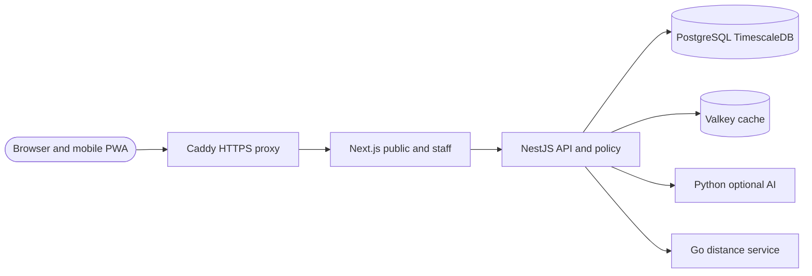

# Prachi Dham Foundation — build report

_Implementation inventory and deployment status · 2 October 2026 · Source branch: `feature/platform-foundation`_

---

## Executive summary

The repository contains a **working foundation**, not the completed 17-system nonprofit platform. It combines a Gujarati-default public site with Hindi and English alternatives, a mobile-installable PWA, an authenticated staff workspace, a reviewed product/service catalog and a Docker Compose reference stack. The catalog can publish approved listings and record availability inquiries only after a privacy gate is enabled; it **cannot accept payments, donations, bookings or orders**.

The source and deployment instructions are ready to take to a Docker-capable Linux host. **No permanent host, DNS, TLS certificate, Docker runtime test or production backup has been provisioned** in this session. This sandbox has the Compose CLI but no Docker daemon. Public search indexing and the structured inquiry form remain off by default.

## Implemented capabilities

| Area | Delivered behavior | Boundary |
|---|---|---|
| Public site | `/` redirects to `/gu`; Gujarati, Hindi and English home, shop, services and contact routes; responsive navigation and locale-specific document language | Public wording, contact details and translations require foundation approval before indexing |
| Search visibility | Locale-specific metadata, canonical/hreflang links for reviewed content, robots rules and sitemap gated by `PUBLIC_SITE_INDEXABLE` | Not an SEO campaign, analytics integration or search-console connector |
| Product/service catalog | PostgreSQL-backed drafts, INR paise amounts, optional product SKU, per-language slugs, owner/admin approval and explicit publication | No inventory, cart, checkout, tax, shipping, payment or receipts |
| Inquiries | Default-off availability inquiry, required privacy-policy URL/version/consent, Valkey rate limiting in production, tenant-scoped staff follow-up | An inquiry is not a sale, donation or reservation |
| Mobile | Logo-derived favicon, Apple and Android icons, web manifest and public-only offline screen | No native mobile app, push notification or offline staff records |
| Staff access | Session-cookie sign-in, five roles, server-side permission checks, organization-scoped queries and a live overview | No SSO/MFA, self-service provisioning or field-level access yet |
| Shared workspaces | Generic title/status/notes records for CRM, ERP, BPM, HRMS, SCM, BI, EAM, PLM, CMS, DMS, ECM, ITS, PSA, CDP, MAP, SEO and GEO | These are **not** 17 complete enterprise suites |
| Controlled workflow | BPM draft → submission → manager-or-higher decision with audit events | Not a configurable workflow engine |
| Intelligence and location | Optional protected Python summary adapter; Go great-circle distance calculator accessed through Nest | No automatic AI use of constituent records, map tiles or full geospatial intelligence |
| Data layer | PostgreSQL with TimescaleDB audit hypertable, pgvector-ready column, restricted application role and Valkey login throttling | No semantic search, database RLS or production disaster-recovery evidence |

The nine supplied PDFs were assessed in [the source assessment](reference-assessment.md). Donation/sponsorship chart totals are **hypothetical contribution scenarios**, not money received. The incorporation documents describe legal identity and objects, not permission to make unverified tax or fundraising claims. None of the legal originals is bundled into the public site or source archive.

## System structure

The production overlay exposes **only Caddy on ports 80/443**; the web, API and data containers stay on a private Compose network. The `web` container serves both public and staff routes from one origin, preserving the session-cookie and `/api/v1/*` proxy behavior.

| Repository path | Purpose |
|---|---|
| `apps/web/` | Next.js localized public pages, staff interface, catalog editor and PWA assets |
| `apps/api/` | NestJS `/v1` API, authentication, roles, records, catalog, inquiry and audit services |
| `services/intelligence/` | FastAPI internal summary adapter, disabled without provider configuration |
| `services/geo/` | Internal Go coordinate-distance service |
| `infra/postgres/` | Base schema, commerce migration, runtime grants and privilege regression check |
| `infra/proxy/Caddyfile` | HTTPS reverse proxy and private response headers |
| `compose.yaml` / `compose.production.yaml` | Base six-service graph and production Caddy/HTTPS override |
| `docs/openapi.yaml` | REST API contract |

## Verification performed

| Check | Evidence available |
|---|---|
| API unit tests and TypeScript build | 27 tests rechecked on 2 October; Nest build/type check passed in the preceding implementation verification |
| Web unit tests and production build | 24 tests rechecked on 2 October; Next build/type check passed in the preceding implementation verification |
| Specialist services | Five Python tests, Go tests and `go vet` rechecked on 2 October |
| Database and permissions | Additive commerce SQL and restricted grants applied on disposable local PostgreSQL; privilege check passed |
| Publication lifecycle | Temporary item: three approved translations → publish → public locale reads → unpublish; test item and session removed |
| Public/private API boundary | Anonymous admin request returned 401; inquiry returned 503 while off; public catalog/config returned 200 |
| Preview and responsive layout | All three language roots, catalog pages, staff page, manifest, worker and favicon served on the temporary preview; desktop/mobile screenshots inspected |
| Deployment syntax | Compose merge and Caddy configuration validated; OpenAPI 3.1 valid with 35 non-blocking style/completeness warnings |

These are **development verification results, not a claim of production readiness**. The Compose containers were **not built or run together** in this sandbox because no Docker daemon is available. The target host still needs an end-to-end deployment, backup/restore drill and security review.

## Deploying with Docker

Use the [README quick start](../README.md#docker-deployment-on-your-server) for a fresh host and the [Docker self-hosting runbook](self-hosting.md) for existing-volume migration, verification, troubleshooting and operations. Docker's [production Compose guide][docker-prod] supports a second Compose file applied with `-f`; Compose merges files in command-line order, so `compose.production.yaml` must follow `compose.yaml`.[^1] Only the Caddy proxy should publish ports in the merged configuration.

Before running `up --build -d`, supply a real DNS name and owner-controlled `.env` with separate high-entropy secrets. Keep `PUBLIC_SITE_INDEXABLE=false` and `PUBLIC_COMMERCE_INQUIRIES_ENABLED=false` until the exact content and privacy workflow are approved. The current Compose reference places secrets in environment variables; for higher assurance, migrate to a secret manager or Compose secrets.[^2]

## Remaining decisions and release gates

1. **Hosting:** Linux host/OS, SSH or provider access, DNS ownership, 80/443 routing, chosen data residency and backup destination.
2. **Public content:** management-approved mission/program wording, contact details, real products/services, SKU/price/availability and professionally reviewed Hindi/Gujarati copy.
3. **Commerce:** approved privacy notice/version, fulfillment/tax/refund rules, merchant onboarding, signed webhook design and reconciliation before any checkout or donation flow. The briefs mention Razorpay, but no gateway is integrated.
4. **Sensitive operations:** SSO/MFA, account recovery, field-level access, database RLS, retention/deletion, encryption, observability, off-site backups with test restore and independent security/legal review.
5. **Platform depth:** dedicated finance/HR/case/document/program schemas, automation and full staff localization remain future increments; generic workspace labels are not proof those suites exist.

The user's Windows-mounted directory was **not modified** because its connected Manus Desktop operator must be updated and reconnected before Work Locally file operations. This project lives in the sandbox source archive until it is moved to the chosen host or another approved repository.

## References

- [Source and legal-reference assessment](reference-assessment.md)
- [Existing implementation delivery status](delivery-status.md)
- [Docker self-hosting runbook](self-hosting.md)
- [API specification](openapi.yaml)
- [Docker production Compose guide][docker-prod]

[^1]: Docker, “Merge Compose files.” https://docs.docker.com/compose/how-tos/multiple-compose-files/merge/
[^2]: Docker, “Manage secrets securely in Docker Compose.” https://docs.docker.com/compose/how-tos/use-secrets/

[docker-prod]: https://docs.docker.com/compose/how-tos/production/
